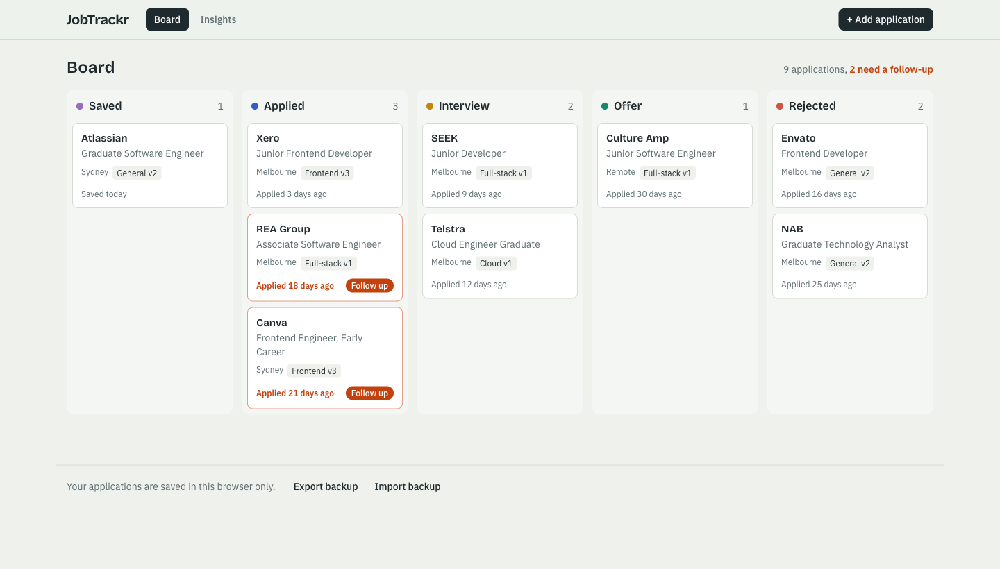
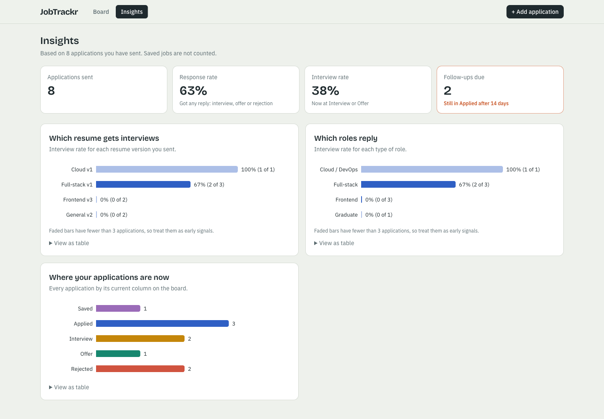
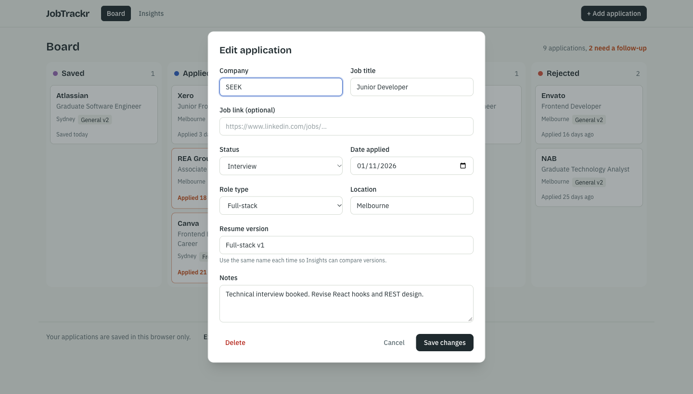
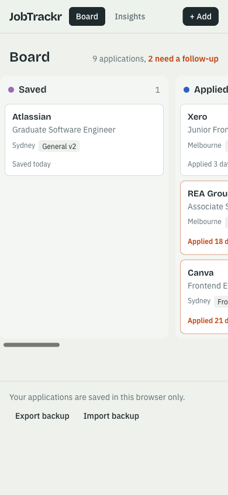

# JobTrackr

[](https://github.com/saichetankari2001/jobtrackr/actions/workflows/ci.yml)

A job application tracker that helps you learn from your job search, not just record it. Move applications across a Kanban board, get flagged when one needs a follow-up, and see which resume version and which kinds of roles actually lead to interviews.

I built it for my own graduate job search: my inbox told me *what* happened to each application, but never *why*.



## Features

- **Kanban board.** Drag applications between Saved, Applied, Interview, Offer and Rejected, with a mouse, by touch, or with the keyboard.
- **Follow-up flags.** Anything still in Applied after 14 days is highlighted, so no application goes quiet unnoticed.
- **Resume version tracking.** Record which tailored resume you sent to each company.
- **Insights.** Response rate, interview rate, and interview rate by resume version and role type. Small samples are marked so one lucky application doesn't read as "100% success".
- **AI follow-up emails, powered by [Matilda](https://maincode.com/matilda/api).** For an application with no reply, Matilda drafts a short follow-up email you can review and copy. Only the company, role and date are sent; your notes never leave the browser.
- **Backup.** Export and import your data as JSON. Imports are validated and merged, never overwritten blindly.
- **Sample data.** One click loads a realistic board, so you can try it without typing anything.

| Insights | Add / edit | Mobile |
|---|---|---|
|  |  |  |

## Tech stack

| Area | Choice | Why |
|---|---|---|
| Framework | React 19 + TypeScript, built with Vite | Type safety and fast builds. Vite outputs static files, ideal for S3 + CloudFront hosting |
| Styling | Tailwind CSS v4 with design tokens | Colours and fonts defined once in `index.css` and used everywhere |
| State | Zustand with `persist` | Small and simple. All data access goes through one store, so swapping localStorage for an API later touches one file |
| Forms | React Hook Form + Zod | One Zod schema is both the TypeScript type and the validation rules |
| Drag and drop | dnd-kit | Maintained, and supports keyboard and screen readers |
| Charts | Recharts, lazy-loaded | Only downloaded when Insights is opened |
| Testing | Vitest + Testing Library | 43 unit and component tests, including full user flows |
| AI | Matilda API (`@maincode-ai/matilda-client-sdk`), called server-side | Australian-made model. The API key lives on the server, never in the browser |
| CI | GitHub Actions | Every push is linted, tested and built on a clean machine |

## Engineering decisions worth calling out

- **Accessibility first.** Keyboard drag and drop with screen-reader announcements, a native `<dialog>` for focus trapping, form errors linked to their inputs, and a table view behind every chart. A component test caught a header button that screen readers would have read as "Addapplication".
- **Colour-blind-safe status palette.** A palette validator showed the original Offer (green) and Rejected (red) colours were indistinguishable with red-green colour blindness (ΔE 1.2). The colours were re-picked to ΔE 7.9, and every status is also labelled in text.
- **Code splitting.** Lazy-loading the Insights page cut the initial JavaScript bundle from 804 KB to 436 KB.
- **Timezone-safe dates.** `new Date('2026-11-06')` is parsed as UTC, which in Melbourne (UTC+11) can land on the wrong day. Dates are parsed as local calendar dates, with tests.
- **Untrusted input is validated.** Backup files are checked record by record with Zod before anything reaches the store.
- **Self-hosted fonts.** No runtime requests to third-party font servers.
- **AI keys stay server-side.** The browser calls its own `/api/follow-up` endpoint; only the server holds the Matilda key. The server builds the prompt from three validated fields (company, role, date), so the endpoint can't be used as a free general-purpose chatbot. Requests are incognito, rate-limited and size-capped. The handler is framework-agnostic, so the same code will run in AWS Lambda.

```
Browser ──POST /api/follow-up {company, title, dateApplied}──▶ API server ──Matilda SDK (API key)──▶ Matilda
        ◀──────────────── { subject, body } ─────────────────            (key never leaves the server)
```

## Project structure

```
src/
  types/        Data model (Zod schema = types + validation)
  store/        Zustand store, the only place data is read or written
  lib/          Pure logic: dates, insights, backup, sample data (unit tested)
  components/   Board, cards, form, modal, charts
  pages/        Board and Insights screens
server/         API server: Matilda follow-up drafting (portable to AWS Lambda)
```

## Run it locally

Requires Node.js 20.19 or later.

```bash
git clone https://github.com/saichetankari2001/jobtrackr.git
cd jobtrackr
npm install
npm run dev        # http://localhost:5173
```

### Optional: AI follow-up emails

1. Create a Matilda API key at [matilda.com/settings/api-keys](https://matilda.com/settings/api-keys).
2. `cp .env.example .env.local` and paste the key into `.env.local` (git-ignored).
3. In a second terminal, run `npm run dev:api`. Vite forwards `/api` requests to it.

Without a key the app works normally; the draft button just explains that AI drafting isn't set up.

| Command | What it does |
|---|---|
| `npm run dev:api` | Start the local API server for AI drafting |
| `npm test` | Run the test suite once |
| `npm run test:watch` | Re-run tests on every change |
| `npm run build` | Type-check and build for production into `dist/` |
| `npm run lint` | Lint with oxlint |

## Roadmap

- [ ] Deploy to AWS: S3 + CloudFront, defined with AWS CDK, deployed by GitHub Actions
- [ ] Sign-in and cloud sync: Cognito, API Gateway, Lambda and DynamoDB
- [ ] Dark mode

## Data and privacy

All data is stored in your browser's localStorage and never sent anywhere. Use **Export backup** to keep a copy or move it to another browser.
